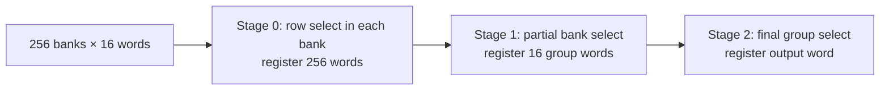

# MAC and FIFO implementation

The upstream MAC has independent host (`logic_clk`), GMII TX (`tx_clk`) and
GMII RX (`rx_clk`) domains. TX crosses host to TX through a frame FIFO; RX
crosses RX to host through another frame FIFO. The standard configuration has
4096 byte entries in each FIFO and an eight-bit host stream. Data plus TLAST and
TUSER occupy ten stored bits per entry.

## Banked read candidate

The optimized derivative keeps the upstream pointers, commit handshake,
drop-policy controller and ready/valid pipeline. It changes the read storage
implementation when `RAM_PIPELINE >= 2` and the depth exceeds sixteen words.
Other configurations retain the original storage behavior.

For a 4096-entry FIFO, twelve address bits are split into four-bit selections:

The three stages consume successive read-clock edges and preserve one-word-per-
cycle throughput. Bank/group selection bits are registered alongside their
corresponding data. Each stage advances using the original pipeline's enable
condition, so stalls do not detach selection from data.

The original MAC configuration uses `RAM_PIPELINE=1`, hence two read-data
pipeline stages. The banked candidate selects `RAM_PIPELINE=2`, hence three.
Comparing the banked candidate against an upstream pipeline-two reference has
identical cycle latency; comparing against the original default adds one
read-clock cycle. The reduced equivalence harness uses the former comparison.

Explicit 16-word arrays are used per bank. An earlier equivalent expression
with one shared array caused a pathological Yosys multiport-memory expansion;
the explicit bank representation avoids that intermediate network.

## Verification and tradeoffs

The reduced bounded reference comparison checks ready, valid, data and TLAST at
depth 32, two data bits, periodic independent clocks and pipeline depth two.
Full-MAC simulation checks the actual 4096-entry/eight-data-bit configuration,
including clock-enable pauses, MII/GMII, backpressure and frame-drop recovery.
This combination is evidence, not an unbounded equivalence proof of every
configuration or all reset sequences.

The banked candidate maps to 87,880 flip-flops, up from 82,434. Standard-cell
memory is large; the synthesized area is the sum of cell areas, not the placed
die/core area. A production design would investigate suitable memory macros
and their port/clock requirements.

Read banking alone did not close the GF180 slow corner. The measured worst
path was from TX FIFO `wr_ptr_reg[6]` through write decode/control into a stored
word. Standard-cell drive strength and fanout remain important. See the
engineering log for all attempted mappings, including unsuccessful ones.

The optional `ONEHOT_WRITE` variant registers bank and row selections alongside
the binary write pointer. Increment/rollback/reset candidates are decoded before
selecting an update. Decode consistency is proved by induction at full TX/RX
dimensions; payload reference equivalence is separately bounded.

The optional `REGISTER_FULL_FLAGS` variant registers `full` and `full_wr` from
the pointer-update path. It uses the second synchronized read-pointer stage and
therefore deliberately trades one or more cycles of ready responsiveness for a
shorter control path. Its proof target is transactional ordering, commit
visibility, stall stability and conservative full-flag consistency; it is not
claimed cycle-equivalent to the combinational-full upstream implementation.

`axis_gmii_rx_lookahead.v` computes CRC from delayed byte d3 rather than d4,
initializes with the first payload byte on SFD recognition, and checks FCS
against the already computed state. Stream latency is unchanged. Full-width RX
reference equivalence was proved by induction using pipeline/state/CRC alignment
invariants, with the scope recorded in `CURRENT_STATUS.md`.

## Physical CDC obligations

The selected pre-layout-closed configuration also enables `WRITE_AHEAD` and
`READ_ONEHOT`. A redundant next-write-pointer register moves the increment out
of the full/decode paths; full-size induction proves it always equals the
current write pointer plus one, including commit, rollback and reset. A one-hot
row register in the elastic address stage drives masked-OR bank reads, with
induction checking row/address alignment. Capacity remains 4096 entries in each
direction and all clocks remain 125 MHz. Two stages of same-family cell sizing
finish selected SS/FF and TT setup/hold closure; `make verify-1g` checks the
selected implementation and `make sta-close-1g` rebuilds its timing flow.

The optional `FAST_CONTROL` variant precomputes incremented write-pointer full
comparison before frame-action selection and explicitly handles commit and
rollback flags. The elastic fetch counter uses a registered carry from its low
four bits to shorten the upper carry chain. Full-size TX/RX induction checks
the carry against the current low-bit reduction, full-flag equality, and write
decode consistency. It adds no latency or relaxed timing exceptions.

The experimental `ELASTIC_READ` variant adds an independent address stage in
front of the existing bank-data, group-selection and output stages. Its valid
bit holds a request whenever the data pipeline cannot accept it. A fetch pointer
reserves the next word, while the read pointer exported to the writer advances
only when bank data is captured. This distinction prevents a stalled request
from returning its storage slot to the producer prematurely. The address stage
adds one cycle of initial latency and permits one word per cycle after filling.
Startup and synchronized source reset clear pending requests and both pointers.
Run `make test-elastic`, `make formal-elastic`, and
`make -f sta/gf180.mk gf180-elastic` to validate this candidate. It is opt-in;
the historical registered-full netlists remain separate timing evidence.

Payload storage is written in one domain and sampled in the other. Valid
payload relies on the pointer/commit protocol making the selected stored word
stable before it is consumed. Sampling unselected banks is not evidence that
all asynchronously changing stored bits are individually synchronized.

Physical implementation must check stable-data flight-time budgets in addition
to pointer/handshake synchronizers and Gray-bus skew. Current asynchronous
clock-group exceptions do not establish these physical properties. No analog
metastability proof or routed signoff has been performed.
