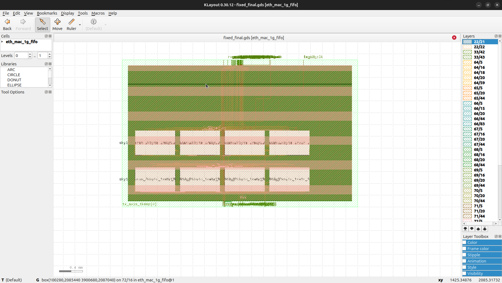

# 1G Ethernet MAC — Sky130 SRAM-backed ASIC flow

This repository contains an open-source RTL, formal-verification, multi-clock
STA, placement, routing, and GDS delivery flow for a 1G Ethernet MAC with
independent logic, TX, and RX clocks.

## Current delivery

The active deliverable is branch `sky130-1r1w-ethernet`:

- Sky130HD, 1.8 V, 125 MHz / 8 ns target
- 4096-entry TX/RX frame FIFOs
- Eight real `sky130_sram_2kbyte_1rw1r_32x512_8` hard macros
- Post-route setup slack **+0.62 ns** and hold slack **+0.13 ns**
- Zero max-slew/max-cap violations and zero detailed-route DRC violations
- Clean top-level integration DRC: **0 report items**
- Final GDS: `build/sky130/fixed_final.gds`, tracked with Git LFS



This is a screenshot of the authoritative routed GDS opened in KLayout 0.30.12;
it shows the 4×2 SRAM macro floorplan, standard-cell rows, and routed metal.
The GDS itself—not the screenshot—is the signoff artifact. See
[CURRENT_STATUS.md](CURRENT_STATUS.md) for measured results and
[WORK_LOG.md](WORK_LOG.md) for the engineering log.

The SRAM is third-party hard IP. Top-level DRC checks the MAC, standard cells,
macro boundary, and routing using a hard-macro integration view; the SRAM
provider owns internal macro signoff. The generic deck's internal macro markers
are retained as evidence and are not top-level MAC violations.

## Get the final GDS

```sh
git lfs install
git clone -b sky130-1r1w-ethernet git@github.com:joeldanphilip/eth-on-gf180.git
cd eth-on-gf180
git lfs pull
```

The final GDS and KLayout screenshot are included in the remote branch. The DEF,
ODB, DRC report, and STA report are retained in the local build workspace and
are listed below for reproducibility.

To inspect the actual layout locally:

```sh
QT_QPA_PLATFORM=xcb physical/bin/klayout-native build/sky130/fixed_final.gds
```

The screenshot above was captured from KLayout; it is not a floorplan
approximation. The launcher defaults to offscreen mode for CI; setting
`QT_QPA_PLATFORM=xcb` opens the normal desktop GUI.

## Historical GF180 study

The remainder of this README retains the original GF180 formal/STA study and
its replay commands. Those results are historical; the Sky130 macro-backed
physical closure above is the current ASIC deliverable.

## Delivered artifacts

- `build/sky130/fixed_final.gds` — complete routed GDS with standard cells,
  fillers, and eight SRAM macro instances.
- `build/sky130/fixed_final.def` — final routed DEF.
- `build/sky130/fixed_final.odb` — final OpenROAD database.
- `build/sky130/fixed_interface.gds` — hard-macro integration view used for
  top-level DRC.
- `build/sky130/fixed_interface.lyrdb` — full Sky130HD DRC report with zero
  items.
- `tools/ORFS/flow/reports/sky130hd/ethernet_sky130_4096/base/6_finish.rpt` —
  final routed STA report.
- `docs/final_layout_klayout.png` — screenshot captured from KLayout showing
  the routed GDS.

Generated build files are ignored by default; the final GDS is force-added via
Git LFS because it is larger than GitHub's normal blob limit.

Start with [WORK_LOG.md](WORK_LOG.md) for the experiments, failures, fixes and
evidence, or [INTERVIEW_GUIDE.md](INTERVIEW_GUIDE.md) for an accurate explanation
of the project. The earlier Nangate45 nominal ECO achieved +6.3073 ns setup
and +0.0009 ns hold; these are historical 45 nm results, not GF180 results.

Implemented around Alex Forencich's MIT-licensed `eth_mac_1g_fifo`: independent
logic, transmit and receive clocks, AXI-Stream host interfaces, GMII PHY interface,
frame FIFOs, TX padding/FCS generation and RX FCS checking. Source revisions and
licenses are recorded in [SOURCES.md](SOURCES.md). Vendor RTL is unmodified;
explicitly selected derivatives are under `rtl/`. Do not compile both versions
of a module together. Build targets select the required files.

## Run on this machine

```sh
make test       # upstream packet suite plus unequal-clock and bad-FCS tests
make formal     # reduced asynchronous FIFO: 30-step BMC and reachability
make synth      # full MAC synthesis and structural checking
make sta        # selected saved 4096-entry MAC: SS/FF + TT, closure gates
make verify-1g  # full MAC simulation, reduced BMC, full-size invariants, saved STA
make sta-close-1g # rebuild selected RTL, two-stage sizing, replay and closure gates
make sta-gf180-3v3 # retain the earlier 3.3 V study
make formal-rx  # unbounded RX equivalence, PTP disabled, modeled startup reset
make formal-onehot # unbounded decode invariants, actual TX/RX FIFO sizes
make test-elastic   # elastic address-stage candidate: full-depth MAC tests
make formal-elastic # 100-step reduced safety BMC and 320-step covers
make test-fast-control # elastic FIFO with optimized frame/full and fetch control
make formal-fast-control formal-fast-invariant # reduced BMC/covers + full-size invariants
make -f sta/gf180.mk gf180-fast-control # isolated 8 ns GF180 control candidate
make test-empty-control # registered-empty candidate, full MAC suite
make formal-empty-control formal-empty-invariant
make -f sta/gf180.mk gf180-empty-control
make test-lookahead-control formal-lookahead-control
make -f sta/gf180.mk gf180-lookahead-control
make -f sta/gf180.mk gf180-elastic # elastic candidate, native 5 V, 8 ns clocks
make -f sta/gf180.mk gf180-registered # registered-full 5 V timing candidate
```

The sibling `../ethernet_sta/Makefile` forwards these targets here. Reports and
generated netlists are under `build/`; packet simulation artifacts also live in
the upstream test directory's `sim_build`. Logs from the initial run include
`simulation.log`, `multiclock.log`, `verified_formal.log`, `mapping.log` and
`timing.log`. Check process completion and final status before interpreting logs.

## Verification scope

The upstream suite checks RX/TX payloads and FCS at many frame lengths, GMII/MII
selection and clock-enable pauses. Project tests use logic/TX/RX periods of
6.400/8.000/8.008 ns, exercising twelve TX frames, four RX frames, and a corrupt
FCS frame that must be dropped. The tests compare received bytes and TX FCS.
The RX test stalls its AXI sink for three cycles out of four, exercising host
backpressure while GMII continues at line rate. Project tests have simulation
timeouts so a hung interface fails the regression.
Additional 3000-byte RX and TX frames exceed the test FIFOs' 2048-byte capacity;
the tests verify that these frames are dropped and that the next valid frame
is received/transmitted correctly, with valid TX FCS.
At the 4096-entry implementation depth, the corresponding oversized frames have
5048 bytes. `make test-closure` selects the one-hot-write/CRC-lookahead variant;
`make test-banked` selects the banked-only implementation.

`formal/fifo_harness.sv` instantiates the upstream asynchronous FIFO at depth 4
with frame mode disabled. Clocks are independent arbitrary signals; reset stays
asserted for the first eight global ticks. There is no fairness assumption.
The producer must hold a stalled beat. Assertions check output stability under
backpressure, no output before an accepted input, and preservation of an
arbitrarily selected input byte and TLAST in order. A cover checks reachable
frame completion. Counters cannot wrap within the configured bound.
An additional task runs 60 global steps with fixed source/sink clock periods
of four/six global ticks. It uses the same assertions but assumes these periodic
clocks explicitly; the 30-step task explores arbitrary clock schedules.

These are bounded safety checks for a reduced FIFO configuration. They do not
establish unbounded MAC correctness, frame-drop policy correctness, liveness,
reset during active traffic or analog metastability behavior. Complete packet
delivery is checked in simulation; the formal harness checks output prefixes.
Additional bounded and unbounded component checks are listed with exact models
in [CURRENT_STATUS.md](CURRENT_STATUS.md). RX reference equivalence is not
independent IEEE certification or a full-MAC unbounded proof.

## Timing scope

`sta/mac.sdc` defines independent logic, TX and RX clocks at 125 MHz. I/O delays
are assigned to their actual domains, with example 1 ns maximum / 0.2 ns minimum
external delays, 0.1 ns uncertainty and 10 fF output loading. Resets are excluded.
Input and ideal clock transitions are modeled at 0.1 ns.
These are explicit study assumptions, to be replaced for a selected board.
Run `make map` for the cell netlist and inspect `build/mapping.log` for structural
errors (this target retains the original Nangate45 study). `make sta` performs
GF180 setup/hold checks with SS/FF views and a TT comparison. `make sta-candidate`
evaluates the 5 V derivative. RAMs are mapped into standard cells, so area is
not representative of a design using compiled SRAM macros.

The asynchronous clock-group exceptions are functional STA exceptions. They
do not verify CDC; physical Gray-pointer bus skew and maximum flight time need
separate constraints/checks before physical signoff. This flow has no placement,
clock tree or routed parasitics. The selected 5 V slow/fast and TT views pass
125 MHz setup/hold; these reports establish pre-layout closure, not routed
multi-corner signoff. The 51.5 ps setup margin still needs physical validation.
The `sta-baseline` target reports the mapped circuit before hold repair.
The retained `sta-nangate` target inserts four BUF_X1 cells at each violating DFF
data pin, checks the inserted chains are logically identical to their original
connections, runs Yosys connectivity checks, and reports the ECO circuit in
`build/timing_hold.log`. `build/hold_remaining.txt` lists any remaining failing
endpoints. This ECO is a nominal study, not a routed hold repair.
The Tcl script also accepts `LIB_MAX` and `LIB_MIN` environment paths for
compatible slow/fast Liberty files. Both must be supplied together and match
the mapped technology's cell names/functions. GF180 targets provide their
own libraries and netlists; reports are in named `build/gf180*` profiles.

Yosys defines `SIMULATION` only to select the upstream LFSR's existing REDUCTION
CRC implementation rather than its slower-to-elaborate LOOP implementation.
The packet tests exercise that same reduction implementation.

## Tools and dependencies

`OSS` in the Makefile defaults to the existing OSS CAD Suite installation under
`../dft/oss-cad-suite`. Override it for another machine. Python dependencies are
in `.venv` and pinned in `requirements.txt`. `scripts/iverilog` and `scripts/vvp`
use the locally extracted Ubuntu Icarus package in `tools/packages/iverilog`.
The SMT wrapper uses system Python and SMT support in `tools/yosys-src` because
the existing suite's bundled Python is incomplete. Adjust these paths when
moving the project.
The local Yosys wrapper uses a copied runtime loader and technology maps from
the source checkout because the installed suite also lacks common mapping
files. It leaves the existing installation unchanged.

The Nangate45 mapping uses `sta/abc.constr` (BUF_X1 driver proxy, 5 fF load) and
a 7000 ps ABC delay target. Actual endpoint loads and clock budgets are checked
separately by OpenSTA. `build/timing_unconstrained_mapping.log` preserves the
initial electrically unconstrained mapping baseline; its enormous fanout
delays motivated the constrained mapping iteration.
GF180 uses `sta/gf180.constr` (`buf_4`, 13.43 fF load) and a 7 ns mapping budget;
the closure candidate uses 5 ns. The actual clock constraint remains 8 ns.
The earlier registered-full candidate measured SS WNS
-0.9877 ns before sizing and -0.9701 ns after a 42-swap replay; it remains an
open slow-corner timing violation.
The elastic read pipeline passes full-depth MAC simulation and reduced FIFO
BMC/covers. Its final 35-change sizing replay measures SS setup -0.8296 ns and
FF hold +0.1578 ns at 125 MHz; that earlier profile missed setup. The selected
write-ahead/one-hot-read profile plus two-stage sizing passes at +0.0515 ns
setup / +0.1578 ns hold in `build/gf180_read_onehot_finish/`.

OpenSTA was built at `tools/OpenSTA/build/sta` using local CUDD, Eigen and SWIG.
Public libraries are in `tools/ORFS/flow/platforms/{gf180,nangate45}/lib`. Source tool
checkouts and generated environments are ignored by Git. To recreate Python:

```sh
python3 -m venv .venv
.venv/bin/pip --isolated install --index-url https://pypi.org/simple -r requirements.txt
```

The full downloaded tool sources remain available locally for rebuilding;
their upstream installation instructions apply on a clean machine.

Run `python3 scripts/check_reports.py` to summarize the saved logs. Formal
results distinguish finite-bound checks from induction proofs. See `sta/CDC.md` for the
crossing inventory and physical checks still needed.

The mapped netlist is cached by Make against its input timestamps, so
rerunning `make sta` after editing the SDC reuses the synthesized circuit.
